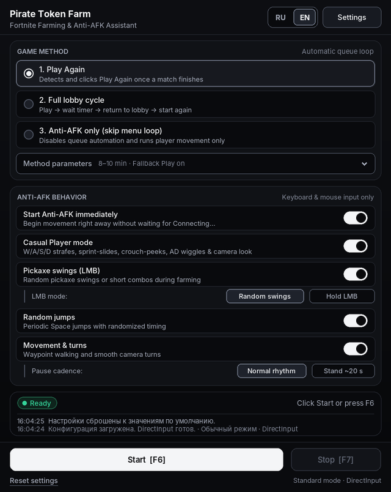

<div align="center">
  
  <h1>Pirate Token Farm</h1>
  <p>Автоперезапуск матчей и Анти-АФК для Fortnite на Windows (OpenCV + DirectInput)</p>

  <p>
    <a href="https://kiingofhate.github.io/pirate-token-farm/">Страница проекта</a> /
    <a href="https://github.com/kiingofhate/pirate-token-farm/releases/latest">Скачать EXE или ZIP</a> /
    <a href="#english">English</a>
  </p>

  <p>
    
    
    
    
  </p>
</div>

<p align="center">
  
  &nbsp;&nbsp;
  
</p>

## Что делает программа

Программа следит за нужными кнопками в окне игры через OpenCV (`mss`) и отправляет обычные системные нажатия клавиатуры и мыши через Windows `SendInput` (аппаратные скан-коды). В память Fortnite она не лезет и файлы игры не меняет.

### Режимы работы

1. **Повторная игра.** Ищет экран конца матча и нажимает «Играть снова». Если включён запасной клик, в лобби нажимает «Играть».
2. **Полный цикл через лобби.** Запускает матч, ждёт случайное время в заданном диапазоне (по умолчанию 8-10 минут, можно выставить до 180), открывает меню, выходит в лобби и заходит заново.
3. **Только Анти-АФК.** Отключает захват экрана и поиск шаблонов, работает только движение персонажа.

### Анти-АФК (режим «Слабый игрок»)

Вместо зажатия одной клавиши по таймеру скрипт перемешивает разные действия и меняет паузы между ними:

- Спринт с подкатом (`W + Shift`, затем `Ctrl`), плавный поворот камеры и выход в прыжок (`Space`) или полный докат.
- Быстрые увороты стрейфами `A` и `D` короткими сериями с небольшой доводкой прицела.
- Короткие приседания, двойные пики и ходьба в приседе с контролем чётности тоггла `Ctrl` (если включена пауза «Стоять ~20 с», выполняется только осмотр на месте).
- Удары киркой: одиночные взмахи, серии по 2-3 удара со стрейфом, удержание ЛКМ или прыжок с поворотом и ударом.
- Краткий прицел ПКМ с плавным ведением (автоматически отключён при удержании ЛКМ).
- Повороты камеры по косинусной кривой с ограничением угла вверх/вниз, редкие оглядки назад и небольшое смещение прицела в паузах.

### Контроль и безопасность

- Никакого чтения или патчинга памяти Fortnite и инжекта DLL, только `GetForegroundWindow`, `IsIconic`, `mss` и `SendInput`.
- Как только окно игры теряет фокус или сворачивается, ввод сразу останавливается. По нажатию `F7` (или другой назначенной клавиши) `release_all()` отпускает все зажатые кнопки и клавиши мыши.
- Интерфейс на Canvas не грузит процессор в простое: плавные 60 FPS анимации работают во время переходов и в активном статусе, а отключение анимаций даёт мгновенный отклик.
- Привязка горячих клавиш (`F6` / `F7` и любых других) использует виртуальные коды клавиш и не зависит от русской или английской раскладки.

---

## Как скачать и запустить

### Готовый EXE (Python не нужен)

1. Скачайте `PirateTokenFarm-win64.exe` или архив `PirateTokenFarm-win64-portable.zip` со страницы [Releases](https://github.com/kiingofhate/pirate-token-farm/releases/latest) или с [сайта проекта](https://kiingofhate.github.io/pirate-token-farm/).
2. Запустите файл от имени администратора (права нужны Windows для работы `SendInput` и глобальных клавиш поверх окна игры).
3. Нажмите `Запустить [F6]` и переключитесь обратно в Fortnite. При переходе на рабочий стол бот уйдёт на паузу.

Готовые `.exe` собираются в GitHub Actions из этого репозитория; рядом в релизе лежит `SHA256SUMS.txt` для проверки файлов.

### Запуск из исходников (Python 3.10+)

```powershell
git clone https://github.com/kiingofhate/pirate-token-farm.git
cd pirate-token-farm
pip install -r requirements.txt
copy settings.example.json settings.json
Start_Pirate_Token_Farm.bat
```

Проверка тестами без открытия окна:

```powershell
$env:PIRATE_HEADLESS="1"
python tests/test_pirate_farm.py
```

---

<h2 id="english">English</h2>

**Pirate Token Farm** is a Windows automation tool for Fortnite written in Python (Tkinter Canvas UI, OpenCV, `mss`, Win32 `SendInput`).

### Features

- **3 modes:** `1. Play Again`, `2. Full lobby cycle` (randomized match timer and lobby requeue), `3. Anti-AFK only` (disables screen capture and OpenCV matching).
- **Varied Anti-AFK:** sprint slides (`W + Shift + Ctrl` into `Space`), `A/D` dodge strafes, crouch peeks with clean `Ctrl` state tracking, pickaxe swings and jump-chops, brief `RMB` ADS glances, idle aim drift, and non-linear camera turns with pitch clamping.
- **Safety checks:** no memory reading, no DLL injection, and no game file changes. Pauses immediately when Fortnite loses focus or gets minimized, and resets all held keys/mouse buttons on `F7`.
- **Automated CI builds:** GitHub Actions runs all 34 unit tests (`PIRATE_HEADLESS=1`) and publishes standalone `.exe` and portable `.zip` builds with `SHA256SUMS.txt` on [Releases](https://github.com/kiingofhate/pirate-token-farm/releases/latest).

### Quick Start

Download the latest release from [Releases](https://github.com/kiingofhate/pirate-token-farm/releases/latest) or the [project page](https://kiingofhate.github.io/pirate-token-farm/), run as Administrator, press `Start (F6)`, and switch back to Fortnite.
