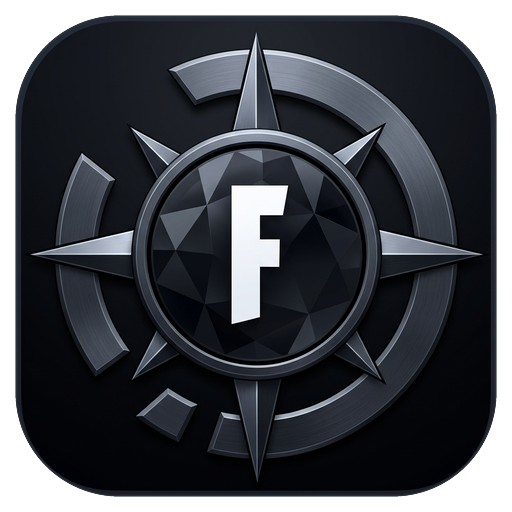
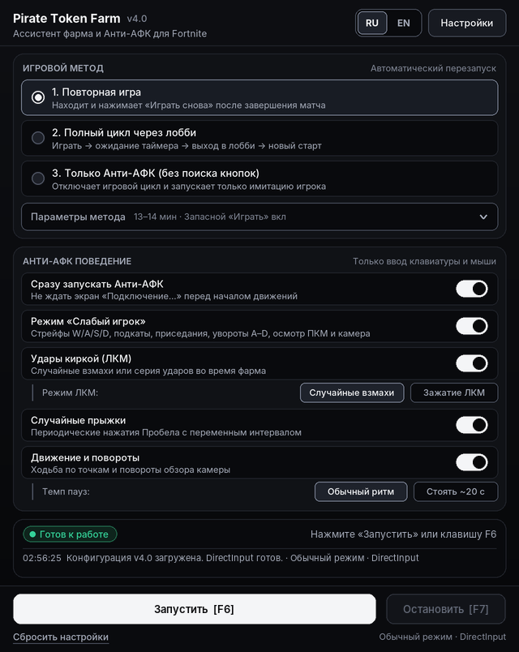

<div align="center">
  
  <h1>Pirate Token Farm v4.0</h1>
  <p><strong>Умный ассистент фарма матчей и человекоподобного Анти-АФК для Fortnite</strong><br />
  <em>Lightweight Windows Match Loop &amp; Human-Like DirectInput Anti-AFK Assistant</em></p>

  <p>
    <a href="https://kiingofhate.github.io/pirate-token-farm/">Сайт проекта (GitHub Pages)</a> ·
    <a href="https://github.com/kiingofhate/pirate-token-farm/releases/latest">Скачать .EXE / Portable ZIP</a> ·
    <a href="#english-overview">English Docs</a>
  </p>

  <p>
    
    
    
    
  </p>
</div>

---

<p align="center">
  
  &nbsp;&nbsp;
  
</p>

## Возможности (RU)

**Pirate Token Farm** объединяет распознавание экранов меню через OpenCV и многослойный генератор человеческого поведения через аппаратные скан-коды Windows (`SendInput`).

### 3 режима работы
1. **Повторная игра** — отслеживает экран окончания матча и нажимает **«Играть снова»** (с опциональным запасным кликом **«Играть»** в лобби).
2. **Полный цикл через лобби** — нажимает **«Играть»**, выдерживает случайный таймер матча (по умолчанию `8–10` мин, настраивается до `180` мин), открывает меню, возвращается в лобби и запускает новый матч.
3. **Только Анти-АФК (без поиска кнопок)** — отключает весь цикл OpenCV / захвата экрана (`0%` нагрузки на зрение) и запускает только имитацию живого игрока.

### Человекоподобный Анти-АФК («Слабый игрок»)
Чтобы поведение не выглядело как периодический макрос, движок комбинирует независимые непериодические действия:
- **Подкаты и прыжки из подката** — разгон на спринте (`W + Shift`), подкат (`Ctrl`), плавный увод камеры и выход прыжком (`Space`) со стрейфом или полным докатом.
- **Увороты стрейфами `A–D`** — короткие неровные серии перекладок (`a`, `d`, `w+a`, `w+d`, `s+a`, `s+d`) с микро-компенсацией прицела.
- **Приседания с осмотром и стрейфом** — короткий стрейф в приседе или двойной «пик» с точным отслеживанием состояния тоггла `Ctrl` (а при активной паузе «Стоять ~20 с» — только осмотр на месте).
- **Удары киркой и прыжок с разворотом** — одиночные удары, серии по `2–3` взмаха со стрейфом, удержание ЛКМ или комбо **прыжок + флик + удар**.
- **Короткий осмотр ПКМ** — кратковременный прицел/осмотр с точной доводкой (автоматически блокируется при режиме зажатия ЛКМ).
- **Живая камера и аритмия** — косинусные движения камеры с анти-наклоном в пол/небо, редкие «оглядки назад» с возвратом взгляда, микро-дрейф в паузах и переменный ритм с чередованием всплесков и пауз.

### Архитектура и безопасность
- **Никакого вмешательства в игру:** программа не читает и не изменяет память процесса Fortnite и не модифицирует файлы игры. Используются только стандартные Win32-вызовы (`GetForegroundWindow`, `IsIconic`, `SendInput`) и захват кадра `mss` для OpenCV.
- **Автопауза и мгновенная остановка:** при сворачивании или переключении окна фокус мгновенно ставит движения на паузу; по `F7` (или вашей горячей клавише) все зажатые клавиши, `LMB` и `RMB` сбрасываются через `release_all()`.
- **Ноль нагрузки в покое:** интерфейс отрисован на многослойном Canvas в обсидиановой палитре; фоновый цикл анимации работает только на `150 мс` переключения тумблеров.
- **Горячие клавиши независимо от раскладки:** привязка кнопок (`F6` / `F7` или любая другая) опирается на аппаратный виртуальный код клавиши — работает одинаково на русской и английской раскладках.

---

## Скачать и запустить (Windows 10 / 11)

### Способ 1 — Готовый EXE (без установки Python)
1. Откройте раздел **[Releases (Последний релиз)](https://github.com/kiingofhate/pirate-token-farm/releases/latest)** или **[сайт проекта](https://kiingofhate.github.io/pirate-token-farm/)**.
2. Скачайте `PirateTokenFarm-v...-win64.exe` (или `PirateTokenFarm-v...-win64-portable.zip`).
3. Запустите приложение **от имени администратора** (необходимо Windows, чтобы `SendInput` и глобальные горячие клавиши работали поверх окна Fortnite).
4. Нажмите **`Запустить [F6]`** и вернитесь в окно игры — при переключении обратно на рабочий стол бот автоматически ставится на паузу.

> [!NOTE]
> Обычный `.exe` собирается автоматически облачным раннером GitHub Actions из исходного кода этого репозитория. Для проверки целостности к каждому релизу прикладывается `SHA256SUMS.txt`.

### Способ 2 — Запуск из исходников (Python 3.10+)
```powershell
git clone https://github.com/kiingofhate/pirate-token-farm.git
cd pirate-token-farm
pip install -r requirements.txt
# Скопируйте пример конфига при необходимости:
copy settings.example.json settings.json
# Запуск от имени администратора:
Start_Pirate_Token_Farm.bat
```

Для запуска встроенных модульных и UI-тестов в безголовом режиме:
```powershell
$env:PIRATE_HEADLESS="1"
python tests/test_pirate_farm.py
```

---

<h2 id="english-overview">English Overview</h2>

**Pirate Token Farm v4.0** is an open-source Windows automation & human-emulation assistant built with Python, Tkinter (Obsidian layered Canvas UI), OpenCV, `mss`, and Win32 DirectInput (`SendInput`).

### Highlights
- **3 selectable modes:** `1. Play Again`, `2. Full lobby cycle` (randomized match timer + return to lobby), `3. Anti-AFK only` (zero OpenCV / screen capture overhead).
- **Rich Casual Player Anti-AFK:** sprint-slides & slide-hops (`W + Shift + Ctrl → Space`), `A–D` dodge wiggles, crouch-peeks/strafes with clean `Ctrl` toggle balance, jump-pickaxe swings, brief `RMB` inspect glides, idle aim micro-drift, eased non-linear camera sweeps with pitch clamping, and burst/relax rhythm timing.
- **Zero memory hooks or file tampering:** relies purely on foreground window detection, `mss` screen capture, and hardware scan-code `SendInput`. All held keys and mouse buttons are released immediately on `Stop (F7)`, window switch (`Alt+Tab`), or menu click.
- **Standalone CI Builds:** GitHub Actions automatically runs all unit tests (`PIRATE_HEADLESS=1`) and packages signed checksum artifacts (`PirateTokenFarm-*-win64.exe` & portable `.zip`) into [Releases](https://github.com/kiingofhate/pirate-token-farm/releases/latest).

### Quick Start
Download the latest executable from **[Releases](https://github.com/kiingofhate/pirate-token-farm/releases/latest)** or visit the **[Project Page](https://kiingofhate.github.io/pirate-token-farm/)**, run as Administrator, press **Start (`F6`)**, and switch focus back to Fortnite.
